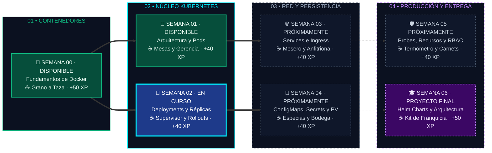

<div align="center">

# ☸️ De Cero a Capitán en Kubernetes
### Workshop Práctico de 6 Semanas — Cloud Native Medellín 🏔️☕

[](https://kubernetes.io/es/)
[](https://ocgroups.dev/cncf/group/2majk4r)
[](https://www.linkedin.com/company/cloud-native-colombia/)
[](https://www.instagram.com/colombiacloudnative/)
[](https://www.youtube.com/@CloudNativeColombia)
[](https://labs.iximiuz.com/trainings/fundamentos-de-docker-y-kubernetes-2ae16ea8/)
[](https://edwinbermudez91.github.io/Fundamentos-Kubernetes/recursos/simulador-interactivo-kubernetes.html)
[](./CONTRIBUTING.md)
[](https://opensource.org/licenses/MIT)

<p align="center">
  <b>Un repositorio vivo construido por y para la comunidad.</b><br>
  Aprende haciendo, rompe cosas sin miedo en tu entorno local y haz tu primer aporte al Open Source.
</p>

[🇨🇴 Únete al Capítulo CNCF Medellín](https://ocgroups.dev/cncf/group/2majk4r) •
[🏢 LinkedIn (@cloud-native-colombia)](https://www.linkedin.com/company/cloud-native-colombia/) •
[📸 Instagram (@colombiacloudnative)](https://www.instagram.com/colombiacloudnative/) •
[📺 Grabaciones en YouTube (@CloudNativeColombia)](https://www.youtube.com/@CloudNativeColombia) •
[🧪 Laboratorios Online en iximiuz](https://labs.iximiuz.com/trainings/fundamentos-de-docker-y-kubernetes-2ae16ea8/) •
[☕ Simulador KubeCafé (Cómo Opera K8s)](https://edwinbermudez91.github.io/Fundamentos-Kubernetes/recursos/simulador-interactivo-kubernetes.html) •
[🎓 Portafolio KubeCafé y Badges](./recursos/portafolio-y-badges.md) •
[📔 Formulario de Bitácora Semanal](https://github.com/edwinbermudez91/Fundamentos-Kubernetes/issues/new?template=bitacora-semanal.yml) •
[⚡ Guía Shell DX (Terminal Pro)](./recursos/guia-shell-dx-kubernetes.md) •
[🔄 Sincronizar tu Fork](./recursos/como-sincronizar-tu-fork.md) •
[📊 Diapositivas (PDF)](./recursos/diapositivas/README.md) •
[☕ Analogía KubeCafé](./recursos/de-un-tinto-a-kubernetes.md) •
[⚓ Guía de Harbor](./recursos/guia-harbor-registry.md) •
[🛡️ Guía de Trivy](./recursos/guia-trivy-seguridad.md) •
[🤖 Guía de Ollama](./recursos/guia-ollama-ia-local.md) •
[📂 Explorador Visual](#directorio-visual) •
[🚀 Empezar Ahora](#paso-0-prepara-tu-laboratorio) •
[🗺️ Mapa de Ruta](#mapa-de-ruta) •
[🏆 Rangos y Premios](#-rangos-de-navegación-y-puntaje-gamificación)

</div>

---

> [!IMPORTANT]
> ### 🧭 Recursos Principales del Workshop
> | 🇨🇴 Comunidad Oficial CNCF | 📺 Grabaciones en Vivo | 🧪 Laboratorios en Navegador | ☕ Simulador KubeCafé |
> | :--- | :--- | :--- | :--- |
> | [](https://ocgroups.dev/cncf/group/2majk4r)<br>[**Registro en CNCF Medellín**](https://ocgroups.dev/cncf/group/2majk4r)<br>Únete a la comunidad oficial para próximos eventos y meetups. | [](https://www.youtube.com/@CloudNativeColombia)<br>[**Canal @CloudNativeColombia**](https://www.youtube.com/@CloudNativeColombia)<br>Revive las grabaciones y explicaciones de cada sesión en vivo. | [](https://labs.iximiuz.com/trainings/fundamentos-de-docker-y-kubernetes-2ae16ea8/)<br>[**Playgrounds de Docker y Kubernetes**](https://labs.iximiuz.com/trainings/fundamentos-de-docker-y-kubernetes-2ae16ea8/)<br>Entorno de laboratorios online para practicar sin instalar nada. | [](https://edwinbermudez91.github.io/Fundamentos-Kubernetes/recursos/simulador-interactivo-kubernetes.html)<br>[**Simulador Interactivo K8s**](https://edwinbermudez91.github.io/Fundamentos-Kubernetes/recursos/simulador-interactivo-kubernetes.html)<br>Aprende visualmente cómo opera Kubernetes y la analogía de KubeCafé. |

> [!TIP]
> 📚 **Documentación Oficial de Referencia:**  
> Consulta siempre las fuentes oficiales para validar especificaciones, APIs, parámetros y buenas prácticas:  
> * 🐳 **Docker:** [Documentación Oficial](https://docs.docker.com/) • [Referencia de Dockerfile](https://docs.docker.com/reference/dockerfile/) • [Referencia de CLI Docker](https://docs.docker.com/reference/cli/docker/) • [Almacenamiento y Volúmenes](https://docs.docker.com/engine/storage/volumes/) • [Redes en Docker](https://docs.docker.com/engine/network/)  
> * ☸️ **Kubernetes (Español):** [Documentación Oficial Principal](https://kubernetes.io/es/docs/home/) • [Cheat Sheet Oficial de kubectl](https://kubernetes.io/es/docs/reference/kubectl/cheatsheet/) • [Componentes y Arquitectura](https://kubernetes.io/es/docs/concepts/overview/components/) • [Cargas de Trabajo (Workloads)](https://kubernetes.io/es/docs/concepts/workloads/)  
> * ☁️ **CNCF y Ecosistema:** [Portal Oficial CNCF](https://www.cncf.io/) • [CNCF Interactive Landscape](https://landscape.cncf.io/) • [Documentación Oficial de Kind](https://kind.sigs.k8s.io/) • [Documentación Oficial de Helm](https://helm.sh/docs/)

> [!TIP]
> **¿Es tu primera vez usando GitHub o Kubernetes?** ¡Estás en el lugar correcto! Tu primera misión toma solo 30 segundos: regístrate en el [**Muro de Asistentes (`ASISTENTES.md`)**](./ASISTENTES.md) usando nuestro [**⛵ Formulario Visual de Registro**](https://github.com/edwinbermudez91/Fundamentos-Kubernetes/issues/new?template=registro-asistente.yml).

> [!NOTE]
> ☕ **Hilo Conductor del Workshop — KubeCafé (La Analogía del Café):**  
> Todo lo que aprenderás desde la **Semana 00** hasta la **Semana 06** está conectado mediante la operación de una cafetería de especialidad de alta escala (**KubeCafé**).  
> * 🎮 **Simulador Interactivo paso a paso:** [**Abrir Simulador en el Navegador**](https://edwinbermudez91.github.io/Fundamentos-Kubernetes/recursos/simulador-interactivo-kubernetes.html) *(o descarga [`recursos/simulador-interactivo-kubernetes.html`](./recursos/simulador-interactivo-kubernetes.html))*  
> * 📖 Guía interactiva con diagramas y retos: [**☕ Kubernetes explicado con la Analogía del Café (`de-un-tinto-a-kubernetes.md`)**](./recursos/de-un-tinto-a-kubernetes.md)  
> * 📊 Presentaciones en PDF: [**🐳 Semana 00 — Fundamentos de Docker**](./recursos/diapositivas/0.Fundamentos-Docker.pdf) | [**☕ Semana 01 — KubeCafé: De Docker a Kubernetes**](./recursos/diapositivas/1.KubeCafe-De-Docker-a-Kubernetes.pdf) | [**☕ Semana 02 — KubeCafé: De un Pod al Deployment**](./recursos/diapositivas/2.KubeCafe-De-un-Pod-al-Deployment.pdf)

> [!IMPORTANT]
> 📢 **¿Hiciste Fork de este repositorio antes?**  
> El repositorio se actualiza cada semana con nuevos retos, bitácoras y mejoras. **Sincroniza tu copia** entrando a tu repositorio en GitHub y haciendo clic en **"Sync fork" ➔ "Update branch"** (o usando `upstream` en tu terminal).  
> 👉 [**Ver la Guía Visual Paso a Paso: Cómo Sincronizar tu Fork sin Conflictos (`recursos/como-sincronizar-tu-fork.md`)**](./recursos/como-sincronizar-tu-fork.md)

---

<a id="directorio-visual"></a>

## 📂 Directorio Visual del Repositorio
*(Navegación rápida por carpetas con logotipos oficiales y acceso directo a cada módulo)*

| Carpeta / Módulo | Tecnología & Estado | Contenido del Directorio |
| :--- | :---: | :--- |
| [**`semana-00-fundamentos-docker/`**](./semana-00-fundamentos-docker) | [](./semana-00-fundamentos-docker)<br>`🟢 DISPONIBLE` | Empaquetado de aplicaciones, imágenes Alpine ligeras, redes bridge y volúmenes persistentes. |
| [**`semana-01-arquitectura/`**](./semana-01-arquitectura) | [](./semana-01-arquitectura)<br>`🟢 DISPONIBLE` | Arquitectura interna (Control Plane vs Workers), creación de Pods y contenedores Sidecar. |
| [**`semana-02-deployments/`**](./semana-02-deployments) | [](./semana-02-deployments)<br>`🔥 EN CURSO` | Controladores de réplicas, autorreparación (*self-healing*), rolling updates con cero caídas y rollbacks. |
| [**`aportes-comunidad/`**](./aportes-comunidad) | [](./aportes-comunidad)<br>`🎓 PORTAFOLIOS` | Entrega de retos rotos (+XP), **Portafolios Profesionales KubeCafé** verificados y bitácoras semanales. |
| [**`recursos/`**](./recursos) | [](./recursos)<br>`🎮 SIMULADOR & DX` | Simulador KubeCafé, diapositivas PDF, [**Shell DX (Terminal Pro)**](./recursos/guia-shell-dx-kubernetes.md), [**Insignias LinkedIn**](./recursos/portafolio-y-badges.md), Trivy, Harbor y Ollama. |
| [**`scripts/`**](./scripts) | [](./scripts)<br>`⚙️ AUTOMATIZACIÓN` | Scripts que validan los retos, calculan puntajes y generan el portafolio de cada estudiante. |

---

<a id="mapa-de-ruta"></a>

## 🗺️ Mapa de Ruta Interactivo (Conectado con ☕ KubeCafé)

<div align="center">

[-00C7B7?style=for-the-badge)](./semana-02-deployments)
[-f59e0b?style=for-the-badge)](./ASISTENTES.md)
[](https://edwinbermudez91.github.io/Fundamentos-Kubernetes/recursos/simulador-interactivo-kubernetes.html)

**Progreso de la Travesía Cloud Native (3 de 7 módulos activos):**  
`🟢 Semana 00` ━━━▶ `🟢 Semana 01` ━━━▶ `🔥 Semana 02 (ACTUAL)` ━━━▶ `⚪ Semana 03` ━━━▶ `⚪ Semana 04` ━━━▶ `⚪ Semana 05` ━━━▶ `⚪ Semana 06`

</div>

Así evolucionaremos paso a paso desde el **grano de café crudo** empaquetado con Docker hasta inaugurar una **franquicia automatizada de alta disponibilidad** en Kubernetes *(haz clic en los bloques o en los botones de la tabla para saltar a cada laboratorio)*:



### 🧭 Tablero de Navegación Rápida por Semana

| Semana | Módulo y Analogía en ☕ KubeCafé | Lo que vas a dominar | XP en Juego | Accesos Directos al Material |
| :---: | :--- | :--- | :---: | :--- |
| **00**<br>🟢 *Activo* | [**De Código a Contenedor con Docker**](./semana-00-fundamentos-docker)<br><sub>🌱 Grano → 📜 Receta → 📦 Bolsa → ☕ Taza</sub> | `Dockerfile`, imágenes OCI, capas, seguridad rootless y puente a Kind/K8s. | **+50 XP**<br><sub>(5 Retos)</sub> | [📖 Guía](./semana-00-fundamentos-docker/README.md) • [🧪 Ejemplos](./semana-00-fundamentos-docker/1.ejemplos) • [💥 Retos](./semana-00-fundamentos-docker/2.reto-roto) • [📚 Docs Docker](https://docs.docker.com/) • [📊 PDF](./recursos/diapositivas/0.Fundamentos-Docker.pdf) |
| **01**<br>🟢 *Activo* | [**El motor por dentro y tu primer Pod**](./semana-01-arquitectura)<br><sub>🍽️ Bandeja (`Pod`), 🪵 Mesas (`Nodes`) y 🏢 Gerencia</sub> | Control Plane vs. Worker Nodes, `kubectl`, Pods multicontenedor y sondas. | **+40 XP**<br><sub>(4 Retos)</sub> | [📖 Guía](./semana-01-arquitectura/README.md) • [🧪 Ejemplos](./semana-01-arquitectura/1.ejemplos) • [💥 Retos](./semana-01-arquitectura/2.reto-roto) • [📚 Docs Pods](https://kubernetes.io/es/docs/concepts/workloads/pods/) • [📊 PDF](./recursos/diapositivas/1.KubeCafe-De-Docker-a-Kubernetes.pdf) |
| **02**<br>🔥 *En Curso* | [**Despliegues sin caídas y autorreparación**](./semana-02-deployments)<br><sub>🧐 Supervisor (`Controller`) y 📝 Orden de Turno</sub> | `ReplicaSets`, `Deployments`, *Self-healing*, *Rolling Updates* y *Rollbacks*. | **+40 XP**<br><sub>(4 Retos)</sub> | [📖 Guía](./semana-02-deployments/README.md) • [🧪 Ejemplos](./semana-02-deployments/1.ejemplos) • [💥 Retos](./semana-02-deployments/2.reto-roto) • [📚 Docs Deployments](https://kubernetes.io/es/docs/concepts/workloads/controllers/deployment/) • [🎮 Simular](https://edwinbermudez91.github.io/Fundamentos-Kubernetes/recursos/simulador-interactivo-kubernetes.html) • [📊 PDF](./recursos/diapositivas/2.KubeCafe-De-un-Pod-al-Deployment.pdf) |
| **03**<br>🔜 *Pronto* | **Conectando todo: Redes en K8s**<br><sub>🤵 Mesero de barra (`Service`) y 🚪 Anfitriona (`Ingress`)</sub> | Comunicación interna y externa: `ClusterIP`, `NodePort`, DNS e `Ingress`. | **+40 XP** | [📚 Docs Services](https://kubernetes.io/es/docs/concepts/services-networking/service/) • *Próxima sesión* 🔒 |
| **04**<br>🔜 *Pronto* | **Configuración y Datos Persistentes**<br><sub>🧂 Especias (`ConfigMap`), 🔐 Caja fuerte y 🏬 Bodega</sub> | Desacoplar configuración con `ConfigMaps`, `Secrets` y volúmenes (`PV`/`PVC`). | **+40 XP** | [📚 Docs ConfigMaps](https://kubernetes.io/es/docs/concepts/configuration/configmap/) • *Próximamente* 🔒 |
| **05**<br>🔜 *Pronto* | **Salud, Límites y Seguridad Básica**<br><sub>🌡️ Termómetro (`Probes`), ⚖️ Agua y 🪪 Carnets (`RBAC`)</sub> | `Liveness/Readiness Probes`, `Requests/Limits` de CPU/RAM y permisos `RBAC`. | **+40 XP** | [📚 Docs Security](https://kubernetes.io/es/docs/concepts/security/) • *Próximamente* 🔒 |
| **06**<br>🔜 *Pronto* | **Empaquetado con Helm y Proyecto Final**<br><sub>🍱 Kit de Franquicia (`Helm Chart`)</sub> | Creación de Charts y despliegue completo de **KubeCafé** en 3 capas. | **+50 XP** | [📚 Docs Helm](https://helm.sh/docs/) • *Gran Misión Final* 🏆 |

---

### 🎒 Explorador Interactivo de Misiones (Haz clic para inspeccionar cada semana)

<details>
<summary><b>🐳 Semana 00: De Código a Contenedor con Docker (🟢 Disponible — Gana +50 XP)</b></summary>
<br>

> ☕ **Misión en KubeCafé:** Antes de abrir una sucursal con múltiples mesas, debes aprender a tostar el grano (`Código`), escribir la receta exacta (`Dockerfile`) y sellar bolsas de café idénticas (`Imágenes OCI`) que sepan igual en cualquier computador.

* 🧪 **Laboratorios Prácticos ([`semana-00-fundamentos-docker/1.ejemplos`](./semana-00-fundamentos-docker/1.ejemplos)):**
  1. Tu primer contenedor y exploración de procesos aislados.
  2. Empaquetado de una API web con `Dockerfile` y variables de entorno.
  3. Construcción *Multi-Stage* y optimización de capas.
  4. Puente hacia Kubernetes: cargar tu imagen local dentro de un clúster **Kind**.
* 💥 **Los 5 Retos Rotos ([`semana-00-fundamentos-docker/2.reto-roto`](./semana-00-fundamentos-docker/2.reto-roto)):**
  `01-dockerfile-roto` • `02-variable-entorno-faltante` • `03-contenedor-como-root` • `04-dockerignore-y-archivos-secretos` • `05-puerto-y-host-desalineado`
* 🚀 [**Entrar a la Semana 00**](./semana-00-fundamentos-docker) | 📊 [**Ver Diapositivas PDF**](./recursos/diapositivas/0.Fundamentos-Docker.pdf)
</details>

<details>
<summary><b>🌱 Semana 01: El Motor por Dentro y tu Primer Pod (🟢 Disponible — Gana +40 XP)</b></summary>
<br>

> ☕ **Misión en KubeCafé:** Inauguramos el local entendiendo cómo la **Oficina de Gerencia (`Control Plane`)** recibe comandas en la **Caja (`API Server`)**, las anota en el **Libro Contable (`etcd`)**, elige una **Mesa libre (`Scheduler`)** y le ordena al **Barista (`kubelet`)** servir tu primera **Bandeja (`Pod`)**.

* 🧪 **Laboratorios Prácticos ([`semana-01-arquitectura/1.ejemplos`](./semana-01-arquitectura/1.ejemplos)):**
  1. `01-mi-primer-pod.yaml` — Tu primera bandeja servida en el clúster.
  2. `02-pod-con-variables-y-recursos.yaml` — Dosificación de agua (RAM) y cafetera (CPU).
  3. `03-pod-multicontenedor-sidecar.yaml` — Café principal + vaso de agua acompañante (*Sidecar*).
  4. `04-pod-sondas-salud.yaml` y `05-pod-ia-inferencia.yaml` — Termómetros de salud y microservicio de IA.
* 💥 **Los 4 Retos Rotos ([`semana-01-arquitectura/2.reto-roto`](./semana-01-arquitectura/2.reto-roto)):**
  `01-pod-con-errores.yaml` (`ImagePullBackOff`) • `02-pod-crashloop.yaml` (`CrashLoopBackOff`) • `03-pod-pendiente-infinito.yaml` (`Pending`) • `04-pod-yaml-molesto.yaml`
* 🚀 [**Entrar a la Semana 01**](./semana-01-arquitectura) | 🖥️ [**Guía Visual Headlamp**](./semana-01-arquitectura/headlamp.md) | 📊 [**Ver Diapositivas PDF**](./recursos/diapositivas/1.KubeCafe-De-Docker-a-Kubernetes.pdf)
</details>

<details open>
<summary><b>🔥 Semana 02 (ESTACIÓN ACTUAL): Despliegues sin Caídas y Autorreparación (🟢 Disponible — Gana +40 XP)</b></summary>
<br>

> ☕ **Misión en KubeCafé:** Un Pod suelto es frágil: si se derrama la taza, nadie la repone. Aquí contratamos al **Supervisor de Barra (`ReplicaSet` + `Deployment`)** para garantizar que **siempre haya 3 baristas activos** (*Self-Healing*) y cambiar la receta del café en caliente sin cerrar la tienda (*Rolling Update* y *Rollback*).

* 🧪 **Laboratorios Prácticos ([`semana-02-deployments/1.ejemplos`](./semana-02-deployments/1.ejemplos)):**
  1. [`01-primer-deployment-replicas.yaml`](./semana-02-deployments/1.ejemplos/01-primer-deployment-replicas.yaml) — 3 réplicas activas + prueba de fuego borrando un Pod en vivo.
  2. [`02-rolling-update-cero-caidas.yaml`](./semana-02-deployments/1.ejemplos/02-rolling-update-cero-caidas.yaml) — Actualización taza por taza con `maxSurge: 1` y `maxUnavailable: 0`.
  3. [`03-estrategia-recreate.yaml`](./semana-02-deployments/1.ejemplos/03-estrategia-recreate.yaml) — Apagado total previo para migraciones críticas.
  4. [`04-deployment-con-recursos-y-probes.yaml`](./semana-02-deployments/1.ejemplos/04-deployment-con-recursos-y-probes.yaml) — Estándar de producción con seguridad rootless y sondas HTTP.
  5. [`05-deployment-ia-inferencia.yaml`](./semana-02-deployments/1.ejemplos/05-deployment-ia-inferencia.yaml) — Clúster escalable del **Barista IA** recomendador de café.
* 💥 **Los 4 Retos Rotos ([`semana-02-deployments/2.reto-roto`](./semana-02-deployments/2.reto-roto)):**
  `01-deployment-selector-roto.yaml` • `02-deployment-imagen-caida-rollback.yaml` • `03-deployment-estrategia-invalida.yaml` • `04-deployment-yaml-identacion.yaml`
* 🚀 [**Entrar a la Semana 02**](./semana-02-deployments) | 🧪 [**Ir a los Ejemplos**](./semana-02-deployments/1.ejemplos) | 💥 [**Resolver los Retos Rotos (+40 XP)**](./semana-02-deployments/2.reto-roto) | 📊 [**Ver Diapositivas PDF**](./recursos/diapositivas/2.KubeCafe-De-un-Pod-al-Deployment.pdf)
</details>

<details>
<summary><b>🔮 Semanas 03 a 06: Vista Previa de las Próximas Estaciones de KubeCafé</b></summary>
<br>

* **🌐 Semana 03 — Redes en K8s (`Services` e `Ingress`):** Pondremos un **Mesero de barra fija (`Service`)** para que los clientes no tengan que perseguir a los Pods cuando cambian de IP, y una **Anfitriona en la puerta (`Ingress`)** que reciba pedidos desde internet por dominio y ruta (`/menu`, `/pagos`).
* **💾 Semana 04 — Configuración y Persistencia (`ConfigMaps`, `Secrets` y `PV`):** Separaremos las **especias (`ConfigMap`)** y la **receta secreta de la casa (`Secret`)** de la bolsa sellada, y conectaremos una **Bodega externa (`PersistentVolume`)** para que los datos sobrevivan aunque se reinicie todo el salón.
* **🛡️ Semana 05 — Operación y Seguridad (`Probes`, `Limits` y `RBAC`):** Instalaremos **termómetros automáticos (`Liveness/Readiness`)**, topes de agua y electricidad por mesa (`ResourceQuotas`) y carnets de empleado con permisos estrictos (`RBAC`).
* **🎓 Semana 06 — Empaquetado con Helm y Proyecto Final:** Crearemos el **Kit de Franquicia (`Helm Chart`)** para inaugurar sucursales completas de KubeCafé (Frontend + API + Base de Datos) con un solo comando `helm install`.
</details>

<details>
<summary><b>☕ Desplegar Vista Rápida de KubeCafé (Tabla de Correspondencia y Glosario Cafetero)</b></summary>
<br>

> 💡 **Glosario rápido de términos cafeteros usados en la analogía:**
> * **👨‍🍳 Barista:** La persona experta que prepara el café detrás de la barra y opera la cafetera (representa al **`kubelet`**).
> * **🪵 Barismo / Mesa de barismo:** El *barismo* es el oficio de preparar café de calidad; la *mesa de barismo* es el mesón o estación de trabajo equipada con agua (**RAM**) y **cafeteras / máquinas de café** (**CPU**) donde trabaja el barista (representa un **`Worker Node`**).
> * **📜 Tostador:** Quien cocina con calor (*tuesta*) y tritura (*muele*) el grano crudo para que quede listo para preparar (el proceso de **`docker build`** con tu **`Dockerfile`**).
> * **🧾 Comanda:** El papelito u orden escrita donde se anota qué pidió el cliente en un restaurante (representa tu archivo **`.yaml`**).
> * **📦 Inmutable:** Sellado de fábrica; no se puede abrir para modificar su contenido, sino que se fabrica un paquete nuevo con otra etiqueta (`v2`).

| Concepto Técnico | Analogía del Café | ¿Cuál es su función? |
| :--- | :--- | :--- |
| **Código Fuente** | 🌱 Grano verde / crudo | Tu receta original y lógica de negocio. |
| **Dockerfile** | 📜 Receta del tostador | Pasos exactos para tostar, moler y empacar. |
| **Imagen Docker** | 📦 Bolsa de café sellada | Paquete inmutable, listo para distribuir en cualquier sucursal. |
| **Contenedor** | ☕ Taza de café servida | La bebida lista y ejecutándose en memoria/CPU. |
| **Pod** | 🍽️ Bandeja de servicio | Unidad mínima: taza de café principal + vaso de agua (*Sidecar*). |
| **Worker Node** | 🪵 Mesa de barismo | Estación de trabajo con agua (RAM) y cafeteras (CPU). |
| **Kubelet** | 👨‍🍳 Barista de la mesa | Recibe órdenes de gerencia y cuida que las tazas no se enfríen. |
| **Control Plane** | 🏢 Oficina de Gerencia | Coordina toda la cafetería sin servir café directamente. |
| **kube-apiserver** | 🛎️ Caja / Mostrador | Ventanilla única: todos los pedidos y comandos entran aquí. |
| **etcd** | 📖 Libro contable | Registro absoluto e inmutable de comandas, recetas y mesas. |
| **kube-scheduler** | 📋 Despachador de mesas | Mira qué mesa tiene cafetera y agua libre para poner la taza. |
| **Controller Manager** | 🧐 Supervisor de salón | Si una taza se derrama, ordena preparar otra inmediatamente. |
| **Service** | 🤵 Mesero de barra fija | Atiende a los clientes con un menú fijo sin importar la taza concreta. |
| **Ingress** | 🚪 Puerta y Anfitriona | Recibe gente de la calle y los encamina según lo que piden (`/frio`, `/postres`). |
| **ConfigMap** | 🧂 Azúcar y especias | Ajusta el sabor sin cambiar la receta sellada de la bolsa. |
| **Secret** | 🔐 Caja fuerte con llaves | Recetas secretas y contraseñas de la caja guardadas bajo llave. |
| **Persistent Volume** | 🏬 Bodega externa | Sacos de café permanentes que no se pierden si se cae una taza. |

👉 [**Abrir la Guía Completa e Interactiva de KubeCafé con Diagramas y Trivia (`recursos/de-un-tinto-a-kubernetes.md`)**](./recursos/de-un-tinto-a-kubernetes.md)
</details>

---

<a id="paso-0-prepara-tu-laboratorio"></a>

## 🛠️ Paso 0: Prepara tu Laboratorio

No necesitas tarjeta de crédito ni cuentas en la nube; todo corre en tu computador. Haz clic abajo según lo que quieras revisar:

<details>
<summary><b>💻 Ver herramientas necesarias (Checklist antes de la Clase 1)</b></summary>
<br>

1. **Contenedores:** [Docker Desktop](https://www.docker.com/products/docker-desktop/) o Docker Engine corriendo.
2. **Clúster Local:** [Kind](https://kind.sigs.k8s.io/) (recomendado por ligero) o [Minikube](https://minikube.sigs.k8s.io/).
3. **Cliente CLI:** [kubectl](https://kubernetes.io/es/docs/tasks/tools/) instalado.
4. **Editor:** [VS Code](https://code.visualstudio.com/) con la extensión oficial de **YAML** y **Kubernetes**.
5. **Gestor de Paquetes:** [Helm](https://helm.sh/) (para desplegar complementos y la consola visual [Headlamp](https://headlamp.dev/)).

👉 *¿Tienes problemas instalando alguno? Entra a [`0.prepara-tu-laboratorio`](./semana-01-arquitectura/0.prepara-tu-laboratorio) para ver guías paso a paso y plantillas de Kind.*
</details>

<details>
<summary><b>⚡ Prueba rápida: ¿Cómo sé si mi computador ya está listo?</b></summary>
<br>

Abre tu terminal y ejecuta estos comandos. Si te responden una versión sin errores, ¡estás listo para despegar!

```bash
docker --version
kind --version   # o minikube version
kubectl version --client
helm version
```
</details>

<details>
<summary><b>🌐 ¿Tu computador tiene pocos recursos? (Laboratorios interactivos en el navegador)</b></summary>
<br>

Si no puedes instalar Docker Desktop o tu máquina no tiene suficiente memoria RAM para levantar clústeres locales, puedes realizar los ejercicios prácticos directamente desde el navegador sin instalar nada:

* 🧪 **Entorno Oficial del Workshop en iximiuz (Recomendado):** [**Laboratorios de Fundamentos de Docker y Kubernetes**](https://labs.iximiuz.com/trainings/fundamentos-de-docker-y-kubernetes-2ae16ea8/)
* 🐳 **Ejercicios complementarios de Docker:** [KodeKloud Studio — Docker Labs](https://kodekloud.com/studio/labs/docker)
* ☸️ **Ejercicios complementarios de Kubernetes:** [KodeKloud Studio — Kubernetes Labs](https://kodekloud.com/studio/labs/kubernetes)

*(No requieren tarjeta de crédito ni instalación local; incluyen terminal lista en la nube).*
</details>

<details>
<summary><b>🚀 Toca tu terminal como un instrumento (Guía Shell DX para Kubernetes: Starship, fzf, Krew y Alias CKA)</b></summary>
<br>

¿Quieres ver en tiempo real en qué clúster y namespace estás parado, autocompletar nombres de Pods con `Tab` y cambiar de entorno en dos teclas?  
👉 [**Abrir la Guía Oficial: Shell DX para Kubernetes (`recursos/guia-shell-dx-kubernetes.md`)**](./recursos/guia-shell-dx-kubernetes.md)
</details>

---

<!-- INICIO_MOSAICO_TRIPULACION -->
## 👥 Tripulación a Bordo y Ranking (48 Tripulantes)

<div align="center">

[](./ASISTENTES.md)
[-2ea44f?style=for-the-badge&logo=github)](https://github.com/edwinbermudez91/Fundamentos-Kubernetes/issues/new?template=registro-asistente.yml)
[](https://github.com/edwinbermudez91/Fundamentos-Kubernetes/issues/new?template=bitacora-semanal.yml)
[](https://github.com/edwinbermudez91/Fundamentos-Kubernetes/issues/new?template=registro-asistente.yml)
[](./ASISTENTES.md)

### 👨‍🏫 Capitán y Colaboradores de la Nave

<table>
  <tr>
    <td align="center" width="150">
      <a href="https://www.linkedin.com/in/edwin-bermudez-cuervo" title="Edwin Bermúdez (@edwinbermudez91)">
        <br/>
        <sub><b>Edwin Bermúdez</b></sub>
      </a><br/>
      <sub>⚓ Capitán • Instructor</sub>
    </td>
    <td align="center" width="150">
      <a href="https://www.linkedin.com/in/santiago-bedoya-diaz/" title="Santiago Bedoya Díaz (@Santiago1023)">
        <br/>
        <sub><b>Santiago Bedoya</b></sub>
      </a><br/>
      <sub>🤝 Colaborador</sub>
    </td>
    <td align="center" width="150">
      <a href="https://www.linkedin.com/in/valentina-p-86b3b913a/" title="Valentina Pinzón Montoya (@vdevalen)">
        <br/>
        <sub><b>Valentina Pinzón</b></sub>
      </a><br/>
      <sub>🤝 Colaboradora</sub>
    </td>
    <td align="center" width="150">
      <a href="https://www.linkedin.com/in/andresqb198/" title="Andrés Quintero Bedoya (@andresqb198)">
        <br/>
        <sub><b>Andrés Quintero</b></sub>
      </a><br/>
      <sub>🤝 Colaborador</sub>
    </td>
    <td align="center" width="150">
      <a href="https://www.linkedin.com/in/karengonzalezanalista/" title="Karen González (@Ka1999)">
        <br/>
        <sub><b>Karen González</b></sub>
      </a><br/>
      <sub>🤝 Colaboradora</sub>
    </td>
  </tr>
</table>

### 🏆 Ranking de la Tripulación (48 Tripulantes)

<table>
  <tr>
    <td align="center" width="140">
      <a href="./aportes-comunidad/soluciones-retos/StivenMunera/README.md" title="Stiven Munera (@StivenMunera) — 100 XP">
        <br/>
        <sub><b>🥇 Stiven Munera</b></sub>
      </a><br/>
      <sub>🧭 Timonel • <b>100 XP</b></sub>
    </td>
    <td align="center" width="140">
      <a href="./aportes-comunidad/soluciones-retos/calichem26/README.md" title="Carlos Andres Montoya Alzate (@calichem26) — 100 XP">
        <br/>
        <sub><b>🥈 Carlos Andres</b></sub>
      </a><br/>
      <sub>🧭 Timonel • <b>100 XP</b></sub>
    </td>
    <td align="center" width="140">
      <a href="./aportes-comunidad/soluciones-retos/Cuburi/README.md" title="Yorman Agudelo (@Cuburi) — 100 XP">
        <br/>
        <sub><b>🥉 Yorman Agudelo</b></sub>
      </a><br/>
      <sub>🧭 Timonel • <b>100 XP</b></sub>
    </td>
    <td align="center" width="140">
      <a href="./aportes-comunidad/soluciones-retos/parte193/README.md" title="Johan Andrés López Zuluaga (@parte193) — 100 XP">
        <br/>
        <sub><b>Johan Andrés</b></sub>
      </a><br/>
      <sub>🧭 Timonel • <b>100 XP</b></sub>
    </td>
    <td align="center" width="140">
      <a href="./aportes-comunidad/soluciones-retos/devdavco/README.md" title="David Corrales (@devdavco) — 60 XP">
        <br/>
        <sub><b>David Corrales</b></sub>
      </a><br/>
      <sub>⛵ Marinero • <b>60 XP</b></sub>
    </td>
    <td align="center" width="140">
      <a href="./aportes-comunidad/soluciones-retos/karolrojas68/README.md" title="Karol Rojas (@karolrojas68) — 60 XP">
        <br/>
        <sub><b>Karol Rojas</b></sub>
      </a><br/>
      <sub>⛵ Marinero • <b>60 XP</b></sub>
    </td>
  </tr>
  <tr>
    <td align="center" width="140">
      <a href="./aportes-comunidad/soluciones-retos/jujo23z/README.md" title="Juan Jose Jaramillo (@jujo23z) — 60 XP">
        <br/>
        <sub><b>Juan Jose</b></sub>
      </a><br/>
      <sub>⛵ Marinero • <b>60 XP</b></sub>
    </td>
    <td align="center" width="140">
      <a href="./aportes-comunidad/soluciones-retos/juanjosegonzalezrosales/README.md" title="Juan José González Rosales (@juanjosegonzalezrosales) — 60 XP">
        <br/>
        <sub><b>Juan José</b></sub>
      </a><br/>
      <sub>⛵ Marinero • <b>60 XP</b></sub>
    </td>
    <td align="center" width="140">
      <a href="./aportes-comunidad/soluciones-retos/RAVILA28/README.md" title="Fernando Avila (@RAVILA28) — 60 XP">
        <br/>
        <sub><b>Fernando Avila</b></sub>
      </a><br/>
      <sub>⛵ Marinero • <b>60 XP</b></sub>
    </td>
    <td align="center" width="140">
      <a href="./aportes-comunidad/soluciones-retos/marnathali/README.md" title="Nathali Anzola (@marnathali) — 60 XP">
        <br/>
        <sub><b>Nathali Anzola</b></sub>
      </a><br/>
      <sub>⛵ Marinero • <b>60 XP</b></sub>
    </td>
    <td align="center" width="140">
      <a href="./aportes-comunidad/soluciones-retos/DrSiker/README.md" title="Didier Alexander Rendón Chaverra (@DrSiker) — 60 XP">
        <br/>
        <sub><b>Didier Alexander</b></sub>
      </a><br/>
      <sub>⛵ Marinero • <b>60 XP</b></sub>
    </td>
    <td align="center" width="140">
      <a href="./aportes-comunidad/soluciones-retos/Camilogigom/README.md" title="Camilo Giraldo (@Camilogigom) — 60 XP">
        <br/>
        <sub><b>Camilo Giraldo</b></sub>
      </a><br/>
      <sub>⛵ Marinero • <b>60 XP</b></sub>
    </td>
  </tr>
  <tr>
    <td align="center" width="140">
      <a href="./aportes-comunidad/soluciones-retos/sanjavier88/README.md" title="Jorge Alberto Monsalve Ruiz (@sanjavier88) — 50 XP">
        <br/>
        <sub><b>Jorge Alberto</b></sub>
      </a><br/>
      <sub>⛵ Marinero • <b>50 XP</b></sub>
    </td>
    <td align="center" width="140">
      <a href="./aportes-comunidad/soluciones-retos/glgaviria64/README.md" title="Gloria Gaviria (@glgaviria64) — 30 XP">
        <br/>
        <sub><b>Gloria Gaviria</b></sub>
      </a><br/>
      <sub>⛵ Marinero • <b>30 XP</b></sub>
    </td>
    <td align="center" width="140">
      <a href="https://www.linkedin.com/in/cristian-camilo-sanchez-bermudez" title="Cristian Sanchez (@ccsanchezb04) — 10 XP">
        <br/>
        <sub><b>Cristian Sanchez</b></sub>
      </a><br/>
      <sub>⛵ Marinero • <b>10 XP</b></sub>
    </td>
    <td align="center" width="140">
      <a href="https://www.linkedin.com/in/luis-tapasco/" title="Luis Tapasco (@Luistapasco) — 10 XP">
        <br/>
        <sub><b>Luis Tapasco</b></sub>
      </a><br/>
      <sub>⛵ Marinero • <b>10 XP</b></sub>
    </td>
    <td align="center" width="140">
      <a href="https://www.linkedin.com/in/dlapaz" title="Eduardo D. La paz (@VivaGarp) — 10 XP">
        <br/>
        <sub><b>Eduardo D.</b></sub>
      </a><br/>
      <sub>⛵ Marinero • <b>10 XP</b></sub>
    </td>
    <td align="center" width="140">
      <a href="https://www.linkedin.com/in/pvargasrodriguez/" title="Paola Vargas (@ypaolavar) — 10 XP">
        <br/>
        <sub><b>Paola Vargas</b></sub>
      </a><br/>
      <sub>⛵ Marinero • <b>10 XP</b></sub>
    </td>
  </tr>
  <tr>
    <td align="center" width="140">
      <a href="https://www.linkedin.com/in/jeraldin-caliz/" title="Jeraldin Caliz (@Jera26) — 10 XP">
        <br/>
        <sub><b>Jeraldin Caliz</b></sub>
      </a><br/>
      <sub>⛵ Marinero • <b>10 XP</b></sub>
    </td>
    <td align="center" width="140">
      <a href="https://linkedin.com/in/kevindazar" title="Kevin Daza (@kevindazardev) — 10 XP">
        <br/>
        <sub><b>Kevin Daza</b></sub>
      </a><br/>
      <sub>⛵ Marinero • <b>10 XP</b></sub>
    </td>
    <td align="center" width="140">
      <a href="https://www.linkedin.com/in/jcrvillamizar" title="Juan Carlos Rodriguez Villamizar (@jcrvillamizar) — 10 XP">
        <br/>
        <sub><b>Juan Carlos</b></sub>
      </a><br/>
      <sub>⛵ Marinero • <b>10 XP</b></sub>
    </td>
    <td align="center" width="140">
      <a href="https://www.linkedin.com/in/airy-nc/" title="Airy Nieves (@aiops88) — 10 XP">
        <br/>
        <sub><b>Airy Nieves</b></sub>
      </a><br/>
      <sub>⛵ Marinero • <b>10 XP</b></sub>
    </td>
    <td align="center" width="140">
      <a href="https://linkedin.com/in/dupegui" title="David Upegui (@DavidUpegui) — 10 XP">
        <br/>
        <sub><b>David Upegui</b></sub>
      </a><br/>
      <sub>⛵ Marinero • <b>10 XP</b></sub>
    </td>
    <td align="center" width="140">
      <a href="https://www.linkedin.com/in/ymqc01" title="Yeison Mateo Quintero Carmona (@mateoqc123) — 10 XP">
        <br/>
        <sub><b>Yeison Mateo</b></sub>
      </a><br/>
      <sub>⛵ Marinero • <b>10 XP</b></sub>
    </td>
  </tr>
  <tr>
    <td align="center" width="140">
      <a href="https://www.linkedin.com/in/diego-mona/" title="Diego Moná (@Hedache77) — 10 XP">
        <br/>
        <sub><b>Diego Moná</b></sub>
      </a><br/>
      <sub>⛵ Marinero • <b>10 XP</b></sub>
    </td>
    <td align="center" width="140">
      <a href="https://www.linkedin.com/in/JhonnyPong/" title="Jhonnatan Gil (@jthan24) — 10 XP">
        <br/>
        <sub><b>Jhonnatan Gil</b></sub>
      </a><br/>
      <sub>⛵ Marinero • <b>10 XP</b></sub>
    </td>
    <td align="center" width="140">
      <a href="https://linkedin.com/in/danielestebanosoriodavid/" title="Daniel Esteban (@da237) — 10 XP">
        <br/>
        <sub><b>Daniel Esteban</b></sub>
      </a><br/>
      <sub>⛵ Marinero • <b>10 XP</b></sub>
    </td>
    <td align="center" width="140">
      <a href="https://www.linkedin.com/in/giovanigonzalogarzonsegura-cloudarchitect" title="Gonzalo Garzon (@ggarzons) — 10 XP">
        <br/>
        <sub><b>Gonzalo Garzon</b></sub>
      </a><br/>
      <sub>⛵ Marinero • <b>10 XP</b></sub>
    </td>
    <td align="center" width="140">
      <a href="https://linkedin.com/in/maria-camila-zapata-arrubla-a594041b1/" title="Maria Camila Zapata Arrubla (@Camilaux) — 10 XP">
        <br/>
        <sub><b>Maria Camila</b></sub>
      </a><br/>
      <sub>⛵ Marinero • <b>10 XP</b></sub>
    </td>
    <td align="center" width="140">
      <a href="https://linkedin.com/in/cristian-gonzalez-9b646a265/" title="Cristian Gonzalez (@CristianCGonzalezO) — 10 XP">
        <br/>
        <sub><b>Cristian Gonzalez</b></sub>
      </a><br/>
      <sub>⛵ Marinero • <b>10 XP</b></sub>
    </td>
  </tr>
  <tr>
    <td align="center" width="140">
      <a href="https://linkedin.com/in/santiagoasz/" title="Santiago Sanchez (@santiagoalex) — 10 XP">
        <br/>
        <sub><b>Santiago Sanchez</b></sub>
      </a><br/>
      <sub>⛵ Marinero • <b>10 XP</b></sub>
    </td>
    <td align="center" width="140">
      <a href="https://www.linkedin.com/in/mao-correa/" title="Hector Mauricio Forero Correa (@maocorrea1015) — 10 XP">
        <br/>
        <sub><b>Hector Mauricio</b></sub>
      </a><br/>
      <sub>⛵ Marinero • <b>10 XP</b></sub>
    </td>
    <td align="center" width="140">
      <a href="https://www.linkedin.com/in/wilfredo-gonzalez-ortiz-5718a2161/" title="Wilfredo Gonzalez (@wilfredogonzalez05) — 10 XP">
        <br/>
        <sub><b>Wilfredo Gonzalez</b></sub>
      </a><br/>
      <sub>⛵ Marinero • <b>10 XP</b></sub>
    </td>
    <td align="center" width="140">
      <a href="https://github.com/Danielgiraldo2010" title="Daniel Giraldo (@Danielgiraldo2010) — 10 XP">
        <br/>
        <sub><b>Daniel Giraldo</b></sub>
      </a><br/>
      <sub>⛵ Marinero • <b>10 XP</b></sub>
    </td>
    <td align="center" width="140">
      <a href="https://linkedin.com/in/emmanuel-uribe-89890525a" title="Emmanuel Uribe (@emmanuel-uribe) — 10 XP">
        <br/>
        <sub><b>Emmanuel Uribe</b></sub>
      </a><br/>
      <sub>⛵ Marinero • <b>10 XP</b></sub>
    </td>
    <td align="center" width="140">
      <a href="https://www.linkedin.com/in/david-garcia-51597469/" title="David García (@manuonda) — 10 XP">
        <br/>
        <sub><b>David García</b></sub>
      </a><br/>
      <sub>⛵ Marinero • <b>10 XP</b></sub>
    </td>
  </tr>
  <tr>
    <td align="center" width="140">
      <a href="https://www.linkedin.com/in/mateo-orozco-cano-21bb90437/" title="Mateo Orozco Cano (@MateoOrozcoCano) — 10 XP">
        <br/>
        <sub><b>Mateo Orozco</b></sub>
      </a><br/>
      <sub>⛵ Marinero • <b>10 XP</b></sub>
    </td>
    <td align="center" width="140">
      <a href="https://github.com/SirJulianM3003" title="Julián Esteban Madrid (@SirJulianM3003) — 10 XP">
        <br/>
        <sub><b>Julián Esteban</b></sub>
      </a><br/>
      <sub>⛵ Marinero • <b>10 XP</b></sub>
    </td>
    <td align="center" width="140">
      <a href="https://www.linkedin.com/in/edwinalexanderrg" title="Edwin Restrepo (@edwin8855) — 10 XP">
        <br/>
        <sub><b>Edwin Restrepo</b></sub>
      </a><br/>
      <sub>⛵ Marinero • <b>10 XP</b></sub>
    </td>
    <td align="center" width="140">
      <a href="https://github.com/MiguelCeballos944" title="Miguel ceballos (@MiguelCeballos944) — 10 XP">
        <br/>
        <sub><b>Miguel ceballos</b></sub>
      </a><br/>
      <sub>⛵ Marinero • <b>10 XP</b></sub>
    </td>
    <td align="center" width="140">
      <a href="https://www.linkedin.com/in/manuela-orozco-jimenez/" title="Manuela Orozco Jimenez (@ManuelaOJ) — 10 XP">
        <br/>
        <sub><b>Manuela Orozco</b></sub>
      </a><br/>
      <sub>⛵ Marinero • <b>10 XP</b></sub>
    </td>
    <td align="center" width="140">
      <a href="https://www.linkedin.com/in/camilo-rendon-3671a0208/" title="Camilo Rendon (@camilorendon08) — 10 XP">
        <br/>
        <sub><b>Camilo Rendon</b></sub>
      </a><br/>
      <sub>⛵ Marinero • <b>10 XP</b></sub>
    </td>
  </tr>
  <tr>
    <td align="center" width="140">
      <a href="https://www.linkedin.com/in/sergio-andres-garcia-jaramillo" title="Sergio Andres Garcia Jaramillo (@sergiogarciaj01) — 10 XP">
        <br/>
        <sub><b>Sergio Andres</b></sub>
      </a><br/>
      <sub>⛵ Marinero • <b>10 XP</b></sub>
    </td>
    <td align="center" width="140">
      <a href="https://www.linkedin.com/in/yepesd/" title="Juan D Yepes (@yepesd86) — 10 XP">
        <br/>
        <sub><b>Juan D</b></sub>
      </a><br/>
      <sub>⛵ Marinero • <b>10 XP</b></sub>
    </td>
    <td align="center" width="140">
      <a href="https://www.linkedin.com/in/josedavid9316/" title="Jose David Moncada Arango (@josedavid9316) — 10 XP">
        <br/>
        <sub><b>Jose David</b></sub>
      </a><br/>
      <sub>⛵ Marinero • <b>10 XP</b></sub>
    </td>
    <td align="center" width="140">
      <a href="https://www.linkedin.com/in/juan-diego-alvarado-gantiva-7801a816a/" title="Juan Diego Alvarado (@juand-alvarado) — 10 XP">
        <br/>
        <sub><b>Juan Diego</b></sub>
      </a><br/>
      <sub>⛵ Marinero • <b>10 XP</b></sub>
    </td>
    <td align="center" width="140">
      <a href="https://github.com/YimmyZuluaga" title="Yimmy Zuluaga (@YimmyZuluaga) — 10 XP">
        <br/>
        <sub><b>Yimmy Zuluaga</b></sub>
      </a><br/>
      <sub>⛵ Marinero • <b>10 XP</b></sub>
    </td>
    <td align="center" width="140">
      <a href="https://www.linkedin.com/in/eandreaja/" title="Andrea Jaramillo (@eandreaja) — 10 XP">
        <br/>
        <sub><b>Andrea Jaramillo</b></sub>
      </a><br/>
      <sub>⛵ Marinero • <b>10 XP</b></sub>
    </td>
  </tr>
</table>

<sub>💡 <b>¿Aún no apareces aquí, quieres actualizar tus redes o registrar tu Bitácora Semanal?</b> Haz clic en <a href="https://github.com/edwinbermudez91/Fundamentos-Kubernetes/issues/new?template=registro-asistente.yml"><b>➕ Registrarme / ✏️ Actualizar Datos</b></a> o en <a href="https://github.com/edwinbermudez91/Fundamentos-Kubernetes/issues/new?template=bitacora-semanal.yml"><b>📔 Llenar Bitácora Semanal</b></a> y nuestro bot actualizará tu tarjeta y portafolio automáticamente en 15 segundos.</sub>

</div>
<!-- FIN_MOSAICO_TRIPULACION -->

---

## 🏆 Rangos de Navegación y Puntaje (Gamificación)

En cada carpeta semanal encontrarás una subcarpeta llamada **`2.reto-roto/`**. Son manifiestos y escenarios con errores de la vida real puestos a propósito. 

A medida que envíes tus Pull Requests (PRs) resolviendo los retos rotos de cada semana, nuestro bot validará que cada archivo corresponda al ejercicio real y sumará **+10 XP por cada reto roto solucionado** en la tabla de posiciones de [`ASISTENTES.md`](./ASISTENTES.md):

* ⛵ **Marinero (10 XP base):** Te registraste en el Muro de la Tripulación en `ASISTENTES.md` (+10 XP adicionales por cada reto roto validado).
* 🧭 **Timonel (2+ Semanas Completadas al 100%):** Resolviste y validaste **todos** los ejercicios de los *Retos Rotos* de al menos 2 semanas (`5/5` en Semana 00, `4/4` en Semana 01, etc.).
* ⚓ **Capitán K8s (6 Semanas Completadas al 100%):** Dominas la navegación del clúster, completaste todos los retos de las 6 semanas y el proyecto final.

### 🎓 Tu Portafolio Profesional KubeCafé, Bitácora de Navegación e Insignias Oficiales

En **Cloud Native Medellín (CNCF)** queremos que tu esfuerzo técnico sea visible en tu carrera profesional. Cada vez que entregas un reto o llenas el [**📔 Formulario Visual de Bitácora Semanal**](https://github.com/edwinbermudez91/Fundamentos-Kubernetes/issues/new?template=bitacora-semanal.yml), nuestro robot genera automáticamente tu **Portafolio Profesional de Aprendizaje** dentro de `aportes-comunidad/soluciones-retos/<tu-usuario>/README.md` y te entrega tus insignias para lucir en **LinkedIn, Instagram, YouTube, GitHub, WhatsApp y Telegram**:

<div align="center">

[](./recursos/portafolio-y-badges.md)
[](./recursos/portafolio-y-badges.md)
[](./recursos/portafolio-y-badges.md)

[-2ea44f?style=for-the-badge&logo=github)](https://github.com/edwinbermudez91/Fundamentos-Kubernetes/issues/new?template=bitacora-semanal.yml)
[](./recursos/portafolio-y-badges.md)

</div>

---

## 🎁 Patrocinadores y Premios

Gracias al apoyo de nuestros aliados y patrocinadores, los tripulantes más destacados en la **Tabla de Posiciones (XP)** que completen los retos semanales participarán por premios e incentivos especiales para impulsar su carrera profesional y técnica:

<div align="center">

| 🏛️ Fundación Antivirus para la Deserción | 🧪 iximiuz Labs |
| :---: | :---: |
| [](https://www.fundacionantivirusparaladesercion.org/es) | [](https://labs.iximiuz.com/) |
| Acompañamiento, mentoría y oportunidades para potenciar la permanencia estudiantil y el crecimiento profesional.<br>👉 **[fundacionantivirusparaladesercion.org/es](https://www.fundacionantivirusparaladesercion.org/es)** | Plataforma interactiva de laboratorios prácticos en contenedores, Linux, Kubernetes y DevOps.<br>👉 **[labs.iximiuz.com](https://labs.iximiuz.com/)** |

</div>

---

## 🤝 ¿Cómo contribuir al repositorio?

Hay muchas formas de sumar a la comunidad (¡no todo es código!):

- 🐛 **Caza errores en los Retos Rotos:** Sube tu solución en [`aportes-comunidad/soluciones-retos/`](./aportes-comunidad/soluciones-retos).
- 📝 **Mejora las explicaciones:** ¿Encontraste una analogía genial en clase? Agrégala al `README.md` de esa semana.
- 🧰 **Alimenta los Cheatsheets:** Comparte tus alias, trucos o comandos favoritos en [`aportes-comunidad/cheatsheets/`](./aportes-comunidad/cheatsheets).
- 🙋 **Toma un Issue:** Revisa la pestaña de [**Issues**](https://github.com/edwinbermudez91/Fundamentos-Kubernetes/issues) con la etiqueta `good first issue`.

📖 **Lee aquí el paso a paso ilustrado: [`CONTRIBUTING.md`](./CONTRIBUTING.md)**

---

<div align="center">
  Hecho con ❤️ y mucho ☕ por la comunidad de <b>Cloud Native Medellín</b>
</div>