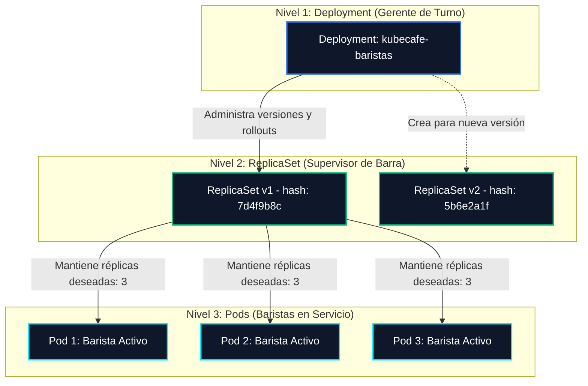

# ☕ Semana 02: Despliegues sin Caídas y Autorreparación

> *"En KubeCafé, si a un barista se le cae una jarra o se enferma a mitad del turno, no cerramos la tienda: hay un supervisor vigilando en todo momento que siempre haya exactamente tres baristas en la barra sirviendo café."*
>
> 📊 **Presentación de la Semana 02 (PDF):** [**Descargar `2.KubeCafe-De-un-Pod-al-Deployment.pdf`**](../recursos/diapositivas/2.KubeCafe-De-un-Pod-al-Deployment.pdf)  
> 🎮 **Simulador KubeCafé (Deployments y Self-Healing):** [**Ver cómo opera Kubernetes en vivo**](https://edwinbermudez91.github.io/Fundamentos-Kubernetes/recursos/simulador-interactivo-kubernetes.html)  
> 🧪 **Laboratorio Online (sin instalación):** [**Playground del Workshop en iximiuz**](https://labs.iximiuz.com/trainings/fundamentos-de-docker-y-kubernetes-2ae16ea8/)  
> 🇨🇴 **Comunidad Oficial CNCF:** [**Únete a Cloud Native Medellín en CNCF Community Groups**](https://ocgroups.dev/cncf/group/2majk4r)  
> 📚 **Documentación Oficial de Kubernetes:** [**Guía Oficial de Deployments**](https://kubernetes.io/es/docs/concepts/workloads/controllers/deployment/) • [**ReplicaSets**](https://kubernetes.io/es/docs/concepts/workloads/controllers/replicaset/) • [**Estrategias de Actualización (RollingUpdate)**](https://kubernetes.io/es/docs/concepts/workloads/controllers/deployment/#rolling-update-deployment) • [**kubectl rollout Cheat Sheet**](https://kubernetes.io/es/docs/reference/kubectl/cheatsheet/#scaling-resources) • [**Sondas de Salud (Liveness/Readiness)**](https://kubernetes.io/es/docs/tasks/configure-pod-container/configure-liveness-readiness-startup-probes/)

---

## 🎯 Objetivos de Aprendizaje

Al finalizar esta semana serás capaz de:
1. **Comprender la diferencia crucial entre un Pod y un Deployment**, y por qué nunca debes desplegar Pods aislados en producción.
2. **Entender el rol del ReplicaSet** como el mecanismo de reconciliación que garantiza el estado deseado (*Desired State vs. Actual State*).
3. **Comprobar la autorreparación (*Self-Healing*) en vivo**: eliminar Pods manualmente y ver cómo el controlador los recrea en milisegundos.
4. **Dominar las estrategias de despliegue**:
   - `RollingUpdate` (*cero tiempo de inactividad* con `maxSurge` y `maxUnavailable`).
   - `Recreate` (*todo o nada*, ideal para migraciones de esquemas o volumenes exclusivos).
5. **Realizar Rollbacks instantáneos** con `kubectl rollout undo` ante versiones fallidas con `ImagePullBackOff` o errores fatales.
6. **Configurar recursos (Requests/Limits) y Probes (Liveness/Readiness)** para proteger la estabilidad de los nodos.
7. **Resolver los 4 retos rotos de la semana** y acumular **+40 XP** en el marcador de la comunidad.

---

## ☕ La Analogía de KubeCafé: El Supervisor de Turno

En la [Semana 01](../semana-01-arquitectura/) aprendiste qué es un **Pod**: es el barista individual preparando tu tinto.
¿El problema? Si el barista se resbala o se va a almorzar, **nadie atiende a los clientes**.



- **Deployment**: Es la orden de contratación y la receta del café. Define: *"Quiero siempre 3 baristas con uniforme v1.0. Si sale el uniforme v2.0, cámbialos uno a uno sin parar la atención"*.
- **ReplicaSet**: Es el supervisor de barra que cuenta cuántos baristas hay trabajando en cada instante. Si hay 2, crea 1. Si hay 4, apaga 1.
- **Pod**: Es el contenedor en ejecución física dentro del nodo.

---

## 📂 Estructura de la Semana

```text
semana-02-deployments/
├── README.md                                # Esta guía principal
├── 1.ejemplos/                              # Manifiestos listos para explorar y ejecutar
│   ├── README.md                            # Paso a paso interactivo de los ejemplos
│   ├── 01-primer-deployment-replicas.yaml   # 3 réplicas + selector + resources
│   ├── 02-rolling-update-cero-caidas.yaml   # RollingUpdate con maxSurge/maxUnavailable
│   ├── 03-estrategia-recreate.yaml          # Estrategia Recreate para migraciones
│   ├── 04-deployment-con-recursos-y-probes.yaml # Health checks + security context
│   └── 05-deployment-ia-inferencia.yaml     # Microservicio barista IA con JSON
└── 2.reto-roto/                             # 4 Retos con errores para reparar (+40 XP)
    ├── README.md                            # Guía de entrega y verificación
    ├── 01-deployment-selector-roto.yaml     # Error: mismatch selector vs template labels
    ├── 02-deployment-imagen-caida-rollback.yaml # Error: ImagePullBackOff y rollback
    ├── 03-deployment-estrategia-invalida.yaml # Error: typo de estrategia y anidamiento
    └── 04-deployment-yaml-identacion.yaml   # Error: apiVersion y sintaxis de indentación
```

---

## 🚀 Laboratorio Práctico: Paso a Paso

### 1. Asegurar tu clúster local activo
Si utilizas **Kind** o **Minikube**:
```bash
# Verificar nodos activos
kubectl get nodes
```

### 2. Desplegar tu primer Deployment de KubeCafé
```bash
kubectl apply -f semana-02-deployments/1.ejemplos/01-primer-deployment-replicas.yaml
```

Verifica la jerarquía de objetos creados automáticamente:
```bash
# Ver el deployment
kubectl get deployments

# Ver el ReplicaSet creado por el deployment
kubectl get replicasets

# Ver los 3 Pods gestionados
kubectl get pods -l app=cafecito -o wide
```

### 3. El Experimento de Autorreparación (Self-Healing)
Elige uno de los Pods y bórralo manualmente:
```bash
# Guarda el nombre de un pod
POD_NAME=$(kubectl get pods -l app=cafecito -o jsonpath='{.items[0].metadata.name}')
echo "Borrando pod: $POD_NAME"

# Elimina el pod
kubectl delete pod $POD_NAME

# Observa de inmediato: Kubernetes ya creó un reemplazo
kubectl get pods -l app=cafecito
```
> 💡 **¿Qué sucedió?** El **Controlador de Réplicas (kube-controller-manager)** detectó que `Actual: 2 != Desired: 3` y ordenó de inmediato al `kube-scheduler` y `kubelet` crear un nuevo Pod idéntico.

### 4. Probar un Rolling Update sin Caídas
Aplica el manifiesto con estrategia de despliegue progresivo:
```bash
kubectl apply -f semana-02-deployments/1.ejemplos/02-rolling-update-cero-caidas.yaml
```

En una terminal abre el monitoreo en vivo:
```bash
kubectl rollout status deployment/api-pedidos-rolling
```

Actualiza la versión en vivo para ver el relevo progresivo de pods:
```bash
kubectl set env deployment/api-pedidos-rolling VERSION=v2.0
kubectl rollout status deployment/api-pedidos-rolling
kubectl rollout history deployment/api-pedidos-rolling
```

### 5. Simular y Resolver un Rollback
Si una versión falla (por ejemplo una imagen que no existe o un bug crítico):
```bash
# Provocar fallo intencional
kubectl set image deployment/api-pedidos-rolling api=python:version-fantasma-999

# Observar cómo el rollout se bloquea pero los pods viejos siguen vivos (cero caídas)
kubectl rollout status deployment/api-pedidos-rolling --timeout=15s
kubectl get pods -l app=api-pedidos

# Deshacer al estado anterior de inmediato
kubectl rollout undo deployment/api-pedidos-rolling
kubectl rollout status deployment/api-pedidos-rolling
```

---

## 🛠️ Comandos Esenciales para Deployments

| Comando | Descripción |
| :--- | :--- |
| `kubectl get deployments` | Lista los deployments y sus réplicas deseadas/actuales |
| `kubectl describe deployment <nombre>` | Muestra eventos, estrategia, selector y réplicas |
| `kubectl scale deployment <nombre> --replicas=5` | Escala horizontalmente el número de Pods |
| `kubectl rollout status deployment <nombre>` | Monitorea en tiempo real el progreso de actualización |
| `kubectl rollout history deployment <nombre>` | Muestra las revisiones del historial de despliegue |
| `kubectl rollout undo deployment <nombre>` | Vuelve a la versión anterior inmediatamente |
| `kubectl rollout undo deployment <nombre> --to-revision=1` | Vuelve a una revisión específica |
| `kubectl rollout restart deployment <nombre>` | Reinicia todos los Pods en secuencia ordenada |

---

## 🥊 Los 4 Retos Rotos de la Semana (+40 XP)

En la carpeta [`2.reto-roto/`](./2.reto-roto/) encontrarás 4 manifiestos dañados que impiden que los pedidos de KubeCafé salgan a producción. Tu misión es corregirlos:

| Reto | Archivo | Error que debes diagnosticar | XP |
| :--- | :--- | :--- | :---: |
| **01** | [`01-deployment-selector-roto.yaml`](./2.reto-roto/01-deployment-selector-roto.yaml) | `matchLabels` no coincide con las etiquetas de los Pods (`template.metadata.labels`). | **+10 XP** |
| **02** | [`02-deployment-imagen-caida-rollback.yaml`](./2.reto-roto/02-deployment-imagen-caida-rollback.yaml) | Imagen inexistente que causa `ImagePullBackOff` y bloquea el servicio. | **+10 XP** |
| **03** | [`03-deployment-estrategia-invalida.yaml`](./2.reto-roto/03-deployment-estrategia-invalida.yaml) | Typo en el valor de la estrategia y parámetros fuera del bloque `rollingUpdate`. | **+10 XP** |
| **04** | [`04-deployment-yaml-identacion.yaml`](./2.reto-roto/04-deployment-yaml-identacion.yaml) | `apiVersion` obsoleto (`v1`) e indentación rota en el bloque `template.spec`. | **+10 XP** |

👉 Revisa la [Guía de Retos Rotos](./2.reto-roto/README.md) para conocer las instrucciones exactas de validación y cómo enviar tu PR para quedar registrado en [ASISTENTES.md](../ASISTENTES.md).

---

## 🌟 Resumen de Buenas Prácticas para Producción

1. **Nunca uses `replicas: 1` en producción**: Pierdes la alta disponibilidad durante los reinicios de nodos. Usa mínimo 2 o 3.
2. **Define siempre `requests` y `limits`**: Evita que un Pod con fuga de memoria agote el nodo (*OOMKilled* a nivel de sistema).
3. **Configura `readinessProbe` con Rolling Updates**: Si no defines un probe de preparación, Kubernetes asume que el Pod está listo en cuanto el contenedor inicia, enviándole tráfico antes de que la aplicación haya calentado.
4. **No uses la etiqueta `:latest` en producción**: Hace imposible saber qué versión de código corre en cada revisión y dificulta los rollbacks fiables. Usa tags semánticos (ej: `v1.2.3` o hash de commit git).
5. **Alinea siempre `matchLabels` con `template.metadata.labels`**: La inmutabilidad del selector impedirá que apliques cambios si no coinciden.

