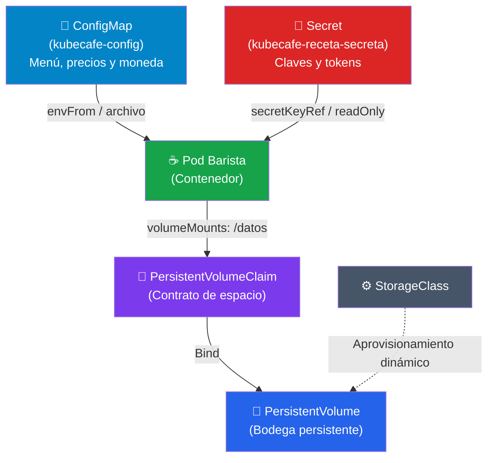

# 💾 Semana 04: Configuración y Datos Persistentes (`ConfigMaps`, `Secrets`, `Volumes` y `PV/PVC`)

> *"En KubeCafé, la receta y los precios del menú (`ConfigMap`) no vienen impresos dentro de la cafetera; y las llaves de la caja fuerte (`Secret`) jamás se dejan a la vista. Además, cuando cerramos el turno y cambiamos de cafetera (se reinicia un Pod), las ventas del día deben guardarse en una **Bodega Externa (`PersistentVolume`)** para no perder ningún dato."*
>
> 🧪 **Laboratorio Online (sin instalación):** [**Playground del Workshop en iximiuz**](https://labs.iximiuz.com/trainings/fundamentos-de-docker-y-kubernetes-2ae16ea8/)  
> 📊 **Presentación de la Semana 04 (PDF):** [**Descargar `4.KubeCafe-Configuracion-y-Almacenamiento.pdf`**](../recursos/diapositivas/4.KubeCafe-Configuracion-y-Almacenamiento.pdf)  
> 🇨🇴 **Comunidad Oficial CNCF:** [**Únete a Cloud Native Medellín en CNCF Community Groups**](https://ocgroups.dev/cncf/group/2majk4r)  
> 📚 **Documentación Oficial:** [**ConfigMaps**](https://kubernetes.io/es/docs/concepts/configuration/configmap/) • [**Secrets**](https://kubernetes.io/es/docs/concepts/configuration/secret/) • [**Volumes**](https://kubernetes.io/es/docs/concepts/storage/volumes/) • [**Persistent Volumes (PV/PVC)**](https://kubernetes.io/es/docs/concepts/storage/persistent-volumes/) • [**StorageClasses**](https://kubernetes.io/es/docs/concepts/storage/storage-classes/) • [**Rancher `local-path-provisioner`**](https://github.com/rancher/local-path-provisioner) • [**StatefulSets**](https://kubernetes.io/es/docs/concepts/workloads/controllers/statefulset/) • [**Headless Services**](https://kubernetes.io/es/docs/concepts/services-networking/service/#headless-services)

---

## 🎯 Objetivos de Aprendizaje

Al finalizar esta semana serás capaz de:
1. **Desacoplar la configuración del código** usando **`ConfigMaps`** (inyectados como variables de entorno o montados como archivos en volúmenes).
2. **Proteger credenciales sensibles** (contraseñas, tokens, API keys) con **`Secrets`** (`Opaque` / `stringData` / Base64).
3. **Diferenciar almacenamiento efímero vs. persistente:** `emptyDir` (vive lo que dura el Pod), `hostPath` (vive en el nodo) y **`PersistentVolume` (`PV`) + `PersistentVolumeClaim` (`PVC`)** (independiente del Pod).
4. **Entender el aprovisionamiento estático vs. dinámico** mediante **`StorageClass`** y comprobar que los datos sobreviven al reinicio o reemplazo de un Pod.
5. **Desplegar bases de datos con identidad estable (`StatefulSet` + `Headless Service`)** como MySQL (`mysql-0`, `volumeClaimTemplates`) conectadas a Backend y Frontend.
6. **Diagnosticar y resolver los 5 retos rotos** (`CreateContainerConfigError`, `Pending` PVC, `volumeMounts`, `MountVolume.SetUp failed`) para ganar **+50 XP**.

---

## ☕ La Analogía de KubeCafé: Especias, Caja Fuerte y Bodega



- **`ConfigMap`:** El tablero de precios y configuración no sensible. Puedes cambiar el menú sin reconstruir la imagen Docker.
- **`Secret`:** La clave de la caja fuerte o contraseña de base de datos. Se almacena codificada y se monta en memoria (`tmpfs`) o como variables protegidas.
- **`emptyDir`:** Una bandeja desechable sobre la barra. Si el Pod se borra, el contenido desaparece.
- **`PersistentVolume` (`PV`) y `PersistentVolumeClaim` (`PVC`):** El `PV` es la bodega física del local; el `PVC` es el contrato/ticket que pide espacio (`500Mi`, `1Gi`) para que tus Pods guarden datos de forma permanente.

---

## 📂 Estructura de la Semana

```text
semana-04-configuracion-almacenamiento/
├── README.md                                       # Esta guía principal
├── 1.ejemplos/                                     # 8 laboratorios guiados paso a paso
│   ├── README.md                                   # Guía interactiva + verificación + limpieza
│   ├── 01-configmap-variables-entorno.yaml         # ConfigMap -> envFrom en Pod
│   ├── 02-configmap-volumen-archivo.yaml           # ConfigMap montado como HTML en Nginx
│   ├── 03-secret-credenciales.yaml                 # Secret Opaque -> env y volumen readOnly
│   ├── 04-volumen-emptydir-vs-hostpath.yaml        # Comparación emptyDir vs hostPath
│   ├── 05-pv-pvc-paso-a-paso.yaml                  # PV (Available) -> PVC (Bound) -> Persistencia entre Pods
│   ├── 06-pv-pvc-almacenamiento-persistente.yaml   # PV + PVC manual + Pod
│   ├── 07-storageclass-dinamico-stateful.yaml      # PVC dinámico + Deployment resistente a reinicios
│   └── 08-statefulset-mysql-headless-app.yaml      # StatefulSet MySQL + Headless Service + Backend + Frontend
└── 2.reto-roto/                                    # 5 Retos con errores (+50 XP)
    ├── README.md                                   # Guía de diagnóstico y entrega
    ├── 01-configmap-clave-inexistente.yaml         # Error: CreateContainerConfigError (key faltante)
    ├── 02-secret-base64-roto.yaml                  # Error: secretKeyRef a Secret/clave inexistente
    ├── 03-pvc-pendiente-storageclass.yaml          # Error: PVC en Pending (StorageClass y tamaño)
    ├── 04-volumen-mountpath-roto.yaml              # Error: volumeMounts.name != volumes.name
    └── 05-configmap-volumen-roto.yaml              # Error: MountVolume.SetUp failed (items.key)
```

---

## 🚀 Inicio Rápido

1. **Explora los 8 laboratorios guiados:**
   Entra a [`1.ejemplos/README.md`](./1.ejemplos/README.md) para practicar `ConfigMaps`, `Secrets`, `emptyDir`, `hostPath`, `PV/PVC`, `StorageClass`, `StatefulSet` y `Headless Service`.
2. **Resuelve los 5 retos rotos (+50 XP):**
   Entra a [`2.reto-roto/README.md`](./2.reto-roto/README.md), reproduce los fallos en tu clúster, repáralos en `aportes-comunidad/soluciones-retos/<tu-usuario>/semana-04/` y envía tu Pull Request.
3. **Documenta tu bitácora (+10 XP):**
   Usa el [Formulario de Bitácora Semanal](https://github.com/edwinbermudez91/Fundamentos-Kubernetes/issues/new?template=bitacora-semanal.yml) eligiendo `semana-04`.
