# 🧪 Ejemplos Prácticos de la Semana 05: Operación, Límites y Seguridad

¡Bienvenido a los laboratorios de la **Semana 05**!  
Esta guía está pensada paso a paso para principiantes, explicando **qué hace cada comando** y **qué respuesta debes esperar en tu terminal**.

Todos los comandos se ejecutan desde la raíz del repositorio (`Fundamentos-Kubernetes`):

```bash
cd Fundamentos-Kubernetes
git pull origin main
```



---

## 📑 Índice de Laboratorios

| Archivo | Concepto Clave | Equivalente en ☕ KubeCafé |
| :--- | :--- | :--- |
| [`01-probes-salud-startup-liveness-readiness.yaml`](./01-probes-salud-startup-liveness-readiness.yaml) | `Startup`, `Readiness` y `Liveness` Probes | Termómetros que verifican si la cafetera ya calentó y si sigue viva. |
| [`02-recursos-limits-oomkilled.yaml`](./02-recursos-limits-oomkilled.yaml) | `requests`, `limits` y `OOMKilled` (`137`) | Tope máximo de agua/energía por mesa para no tumbar el local. |
| [`03-namespace-resourcequota-limitrange.yaml`](./03-namespace-resourcequota-limitrange.yaml) | `Namespace`, `ResourceQuota` y `LimitRange` | Presupuesto total asignado a una sucursal de KubeCafé. |
| [`04-security-context-nonroot.yaml`](./04-security-context-nonroot.yaml) | `SecurityContext` no-root y rootfs `readOnly` | Barista trabajando con equipo de protección y sin llaves maestras. |
| [`05-rbac-serviceaccount-role.yaml`](./05-rbac-serviceaccount-role.yaml) | `ServiceAccount`, `Role` y `RoleBinding` | Carnet de empleado con permiso solo para consultar pedidos, no borrarlos. |
| [`06-networkpolicy-aislamiento.yaml`](./06-networkpolicy-aislamiento.yaml) | `NetworkPolicy` (Pod-a-Pod con Cilium) | Puerta de acceso a la caja fuerte: solo entra el Backend autorizado. |

---

## 🌡️ Lab 1: Sondas de Salud (`Startup`, `Readiness` y `Liveness`)

### 💡 ¿Qué aprenderás?
- **`startupProbe`:** espera a que la aplicación termine de arrancar antes de activar las otras sondas.
- **`readinessProbe`:** indica si el Pod está listo para recibir tráfico; si falla, **lo saca de `Endpoints`** del `Service` sin reiniciarlo.
- **`livenessProbe`:** detecta si el proceso se quedó colgado; si falla, **reinicia el contenedor**.

### Paso 1: Despliega la cafetera con sondas y verifica `Endpoints`
```bash
kubectl apply -f semana-05-operacion-seguridad/1.ejemplos/01-probes-salud-startup-liveness-readiness.yaml
kubectl wait --for=condition=ready pod -l app=cafetera-probes --timeout=90s
kubectl describe pod -l app=cafetera-probes | grep -E "Startup|Liveness|Readiness"
kubectl get endpoints cafetera-probes-svc
```
> 💡 **Respuesta esperada:** verás las tres sondas configuradas y `cafetera-probes-svc` mostrará la IP del Pod en `ENDPOINTS`.

### Paso 2: Simula un fallo de `Readiness` (sin reiniciar el Pod)
```bash
# Borramos /tmp/ready dentro del contenedor -> falla readinessProbe
kubectl exec deployment/cafetera-probes -- rm -f /tmp/ready
sleep 8
kubectl get pods -l app=cafetera-probes
kubectl get endpoints cafetera-probes-svc
```
> 💡 **Respuesta esperada:**
> - El Pod pasa a **`0/1 Running`** (con **`RESTARTS: 0`**, no se reinició).
> - En `kubectl get endpoints cafetera-probes-svc`, la IP **desaparece** (`<none>`) para que no le llegue tráfico hasta volver a estar sano (`kubectl exec deployment/cafetera-probes -- touch /tmp/ready`).

---

## ⚡ Lab 2: `requests`, `limits` y Simulación de `OOMKilled` (`Exit Code 137`)

### 💡 ¿Qué aprenderás?
Cuando un contenedor intenta consumir más memoria RAM de la permitida en `resources.limits.memory`, el kernel de Linux lo detiene inmediatamente con **`OOMKilled` (`Out Of Memory`)** y código de salida **`137`**.

```bash
kubectl apply -f semana-05-operacion-seguridad/1.ejemplos/02-recursos-limits-oomkilled.yaml
kubectl get pods -l app=oom-demo -w
# Presiona Ctrl+C tras ver el estado OOMKilled / CrashLoopBackOff y revisa el detalle:
kubectl describe pod -l app=oom-demo | grep -A 8 "Last State"
```
> 💡 **Respuesta esperada:**
> ```text
>     Last State:     Terminated
>       Reason:       OOMKilled
>       Exit Code:    137
> ```
> *(Opcional si tienes `metrics-server`: `kubectl top pod -l app=oom-demo`).*

---

## 🏢 Lab 3: `Namespace`, `ResourceQuota` y `LimitRange`

### 💡 ¿Qué aprenderás?
- **`ResourceQuota`:** tope total de CPU, memoria y cantidad de Pods permitidos dentro de un `Namespace`.
- **`LimitRange`:** asigna `requests` y `limits` **por defecto** a cualquier Pod que entre al `Namespace` sin declararlos.

```bash
kubectl apply -f semana-05-operacion-seguridad/1.ejemplos/03-namespace-resourcequota-limitrange.yaml
kubectl get quota,limitrange -n kubecafe-sucursal
kubectl describe resourcequota cuota-sucursal -n kubecafe-sucursal
kubectl describe pod barista-con-limites -n kubecafe-sucursal | grep -A 6 "Limits"
```
> 💡 **Respuesta esperada:** aunque `barista-con-limites` no declaró `resources`, verás `Limits:` y `Requests:` inyectados automáticamente por el `LimitRange`, y el `ResourceQuota` reflejando el uso acumulado.

---

## 🛡️ Lab 4: Endurecimiento de Contenedor (`SecurityContext`)

### 💡 ¿Qué aprenderás?
Por buenas prácticas de seguridad, los contenedores nunca deben correr como `root` (`UID 0`) ni poder modificar binarios del sistema operativo.

```bash
kubectl apply -f semana-05-operacion-seguridad/1.ejemplos/04-security-context-nonroot.yaml
kubectl wait --for=condition=ready pod/pod-endurecido --timeout=60s

# 1. Comprobar que NO corre como root
kubectl exec pod-endurecido -- id

# 2. Comprobar que el sistema de archivos raíz es de solo lectura
kubectl exec pod-endurecido -- touch /etc/prueba.txt || echo "Bloqueado por readOnlyRootFilesystem"
```
> 💡 **Respuesta esperada:**
> - `id` devuelve **`uid=10001 gid=10001`** (usuario no-root).
> - `touch /etc/prueba.txt` falla con **`Read-only file system`**.

---

## 🪪 Lab 5: Control de Acceso `RBAC` (`ServiceAccount` + `Role` + `RoleBinding`)

### 💡 ¿Qué aprenderás?
Con **RBAC** aplicamos el principio de mínimo privilegio: creamos un carnet (`ServiceAccount`), definimos permisos de solo lectura (`Role`) y los conectamos (`RoleBinding`).

```bash
kubectl apply -f semana-05-operacion-seguridad/1.ejemplos/05-rbac-serviceaccount-role.yaml

# Verificar permisos directamente con kubectl auth can-i:
kubectl auth can-i get pods --as=system:serviceaccount:default:barista-readonly
kubectl auth can-i delete pods --as=system:serviceaccount:default:barista-readonly
kubectl auth can-i get secrets --as=system:serviceaccount:default:barista-readonly
```
> 💡 **Respuesta esperada:**
> - `get pods` ➔ **`yes`**
> - `delete pods` ➔ **`no`**
> - `get secrets` ➔ **`no`**

---

## 🧱 Lab 6: Aislamiento de Red con `NetworkPolicy`

### 💡 ¿Qué aprenderás?
Por defecto en Kubernetes, todos los Pods pueden hablar con todos. Con una **`NetworkPolicy`** cerramos la puerta para que solo Pods con la etiqueta `rol=backend` puedan conectarse a `bd-secreta`.

```bash
kubectl apply -f semana-05-operacion-seguridad/1.ejemplos/06-networkpolicy-aislamiento.yaml
kubectl wait --for=condition=ready pod/bd-secreta pod/app-autorizada pod/app-intrusa --timeout=60s

# 1. Desde app-autorizada (label rol=backend) -> CONECTA:
kubectl exec app-autorizada -- wget -qO- --timeout=2 http://bd-secreta-svc

# 2. Desde app-intrusa (sin label rol=backend) -> BLOQUEADA (timeout):
kubectl exec app-intrusa -- wget -qO- --timeout=2 http://bd-secreta-svc || echo "Bloqueada por NetworkPolicy"
```
> 💡 **Respuesta esperada:** `app-autorizada` recibe la respuesta HTTP del servicio, mientras `app-intrusa` expira por timeout e imprime **`Bloqueada por NetworkPolicy`**. *(Nota: requiere un CNI que soporte NetworkPolicy, como Cilium o Calico).*

---

## 🧹 Limpieza de los Ejemplos
```bash
kubectl delete -f semana-05-operacion-seguridad/1.ejemplos/06-networkpolicy-aislamiento.yaml --ignore-not-found
kubectl delete -f semana-05-operacion-seguridad/1.ejemplos/05-rbac-serviceaccount-role.yaml --ignore-not-found
kubectl delete -f semana-05-operacion-seguridad/1.ejemplos/04-security-context-nonroot.yaml --ignore-not-found
kubectl delete -f semana-05-operacion-seguridad/1.ejemplos/03-namespace-resourcequota-limitrange.yaml --ignore-not-found
kubectl delete -f semana-05-operacion-seguridad/1.ejemplos/02-recursos-limits-oomkilled.yaml --ignore-not-found
kubectl delete -f semana-05-operacion-seguridad/1.ejemplos/01-probes-salud-startup-liveness-readiness.yaml --ignore-not-found
```
