# 🧪 Ejemplos Prácticos de la Semana 06: Helm en Acción

¡Bienvenido a los laboratorios de la **Semana 06**!  
Aquí aprenderás a empaquetar, parametrizar, desplegar, actualizar, revertir y probar aplicaciones en Kubernetes usando **Helm** paso a paso.

Todos los comandos se ejecutan desde la raíz del repositorio (`Fundamentos-Kubernetes`):

```bash
cd Fundamentos-Kubernetes
git pull origin main
```



---

## 📑 Índice de Laboratorios

| Lab | Tema | Comandos clave |
| :-: | :--- | :--- |
| **01** | Repositorios y Charts públicos | `helm repo add`, `helm search repo`, `helm show values`, `helm install --dry-run` |
| **02** | Anatomía de [`kubecafe-chart/`](./kubecafe-chart) | `helm create`, `Chart.yaml`, `values.yaml`, `templates/`, `NOTES.txt` |
| **03** | Validación y múltiples entornos (`dev` vs `prod`) | `helm lint`, `helm template`, `-f values-prod.yaml`, `helm list` |
| **04** | Ciclo de vida: `upgrade`, `history` y `rollback` | `helm upgrade`, `helm history`, `helm rollback`, `helm get values` |
| **05** | Pruebas automatizadas con `helm test` | `templates/tests/test-connection.yaml`, `helm test <release> --logs` |

---

## 📦 Lab 1: Instalar un Chart desde un Repositorio Oficial

### 💡 ¿Qué aprenderás?
Así como Docker tiene Docker Hub y Linux tiene `apt`, Helm usa **repositorios de Charts** listos para instalar software como Nginx, PostgreSQL o Prometheus.

```bash
# 1. Agregar el repositorio de Bitnami y actualizar su índice local
helm repo add bitnami https://charts.bitnami.com/bitnami
helm repo update

# 2. Buscar Charts disponibles e inspeccionar sus valores configurables
helm search repo bitnami/nginx
helm show values bitnami/nginx | head -n 30

# 3. Simular una instalación sin aplicar nada en el clúster (--dry-run)
helm install demo-nginx bitnami/nginx --dry-run --debug | head -n 40
```
> 💡 **Respuesta esperada:** verás la lista de parámetros (`values.yaml`) de `bitnami/nginx` y los manifiestos Kubernetes generados en pantalla sin crear todavía ningún objeto en tu clúster.

---

## 🏗️ Lab 2: Explora `kubecafe-chart/` y crea tu propio Chart con `helm create`

```bash
# 1. Inspeccionar la estructura del Chart oficial del workshop:
ls -R semana-06-helm/1.ejemplos/kubecafe-chart

# 2. (Opcional) Generar un esqueleto nuevo de práctica en /tmp:
helm create /tmp/mi-primer-chart
```
> 💡 **Qué significa cada archivo:**
> - **`Chart.yaml`**: metadatos del paquete (nombre, descripción y versión SemVer `version: 0.1.0`).
> - **`values.yaml`**: valores por defecto (réplicas, imagen, puerto, mensaje).
> - **`templates/`**: plantillas Go (`{{ .Values.replicaCount }}`) que Helm rellena al desplegar, junto a `NOTES.txt` y `templates/tests/`.

---

## 🔍 Lab 3: `helm lint`, `helm template` y Despliegue por Entornos (`dev` vs `prod`)

### 💡 ¿Qué aprenderás?
Con un **mismo Chart** puedes desplegar múltiples entornos (`dev`, `qa`, `prod`) cambiando únicamente el archivo de valores (`-f values-prod.yaml`).

```bash
# 1. Validar sintaxis y buenas prácticas del Chart antes de tocar el clúster
helm lint semana-06-helm/1.ejemplos/kubecafe-chart

# 2. Renderizar los manifiestos finales en pantalla sin aplicarlos
helm template kubecafe-dev semana-06-helm/1.ejemplos/kubecafe-chart

# 3. Desplegar entorno DEV (usa values.yaml por defecto)
helm install kubecafe-dev semana-06-helm/1.ejemplos/kubecafe-chart

# 4. Desplegar entorno PROD sobrescribiendo con values-prod.yaml
helm install kubecafe-prod semana-06-helm/1.ejemplos/kubecafe-chart \
  -f semana-06-helm/1.ejemplos/kubecafe-chart/values-prod.yaml

# 5. Listar los releases activos y los recursos creados
helm list
kubectl get deployments,svc
```
> 💡 **Respuesta esperada:**
> - `helm lint` imprime **`1 chart(s) linted, 0 chart(s) failed`**.
> - `helm list` muestra **`kubecafe-dev`** y **`kubecafe-prod`** en estado **`deployed`** (`REVISION: 1`).

---

## 🔄 Lab 4: `helm upgrade`, `helm history` y `helm rollback`

### 💡 ¿Qué aprenderás?
Helm guarda un **historial de revisiones** de cada despliegue. Si una nueva versión falla, puedes volver atrás con un solo comando.

```bash
# 1. Escalar el release DEV a 3 réplicas con --set y revisar historial
helm upgrade kubecafe-dev semana-06-helm/1.ejemplos/kubecafe-chart --set replicaCount=3
helm history kubecafe-dev
helm get values kubecafe-dev

# 2. Simular un despliegue roto (tag de imagen inexistente)
helm upgrade kubecafe-dev semana-06-helm/1.ejemplos/kubecafe-chart --set image.tag=no-existe-999
kubectl get pods -l app.kubernetes.io/instance=kubecafe-dev

# 3. Revertir al instante a la revisión 1 sana
helm rollback kubecafe-dev 1
helm history kubecafe-dev
```
> 💡 **Respuesta esperada:**
> - Tras el upgrade roto verás Pods en `ImagePullBackOff` / `ErrImagePull`.
> - Tras `helm rollback kubecafe-dev 1`, los Pods vuelven a **`Running`** y `helm history kubecafe-dev` registra una nueva revisión marcada como **`Rollback to 1`**.

---

## 🧪 Lab 5: Pruebas Automatizadas con `helm test`

El archivo [`kubecafe-chart/templates/tests/test-connection.yaml`](./kubecafe-chart/templates/tests/test-connection.yaml) define un Pod con la anotación `"helm.sh/hook": test` que valida la conectividad HTTP al `Service`.

```bash
helm test kubecafe-dev --logs
```
> 💡 **Respuesta esperada:**
> ```text
> NAME: kubecafe-dev
> ...
> TEST SUITE:     kubecafe-dev-test-connection
> Phase:          Succeeded
> ```
> Junto a los logs de respuesta HTTP confirmando que el release responde correctamente.

---

## 🧹 Limpieza de los Ejemplos
```bash
helm uninstall kubecafe-dev kubecafe-prod || true
rm -rf /tmp/mi-primer-chart
```
